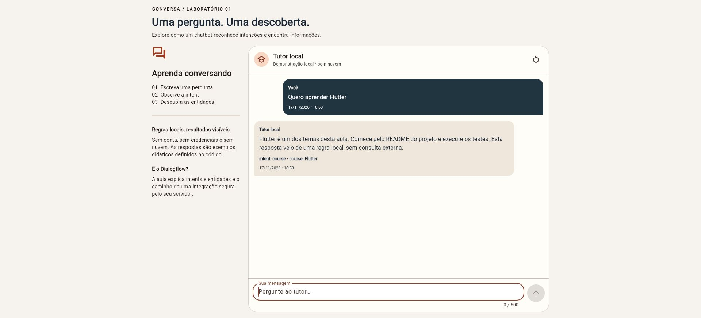

# Conversa — Flutter Chatbot Lab

[](https://github.com/kleberandrade/chatbot-aulas-flutter/actions/workflows/flutter.yml)
[](https://docs.flutter.dev/install/archive)
[](pubspec.yaml)
[](LICENSE)

A conversational classroom for learning messages, intents, entities and safe integration boundaries. The shipped tutor uses **explicit local rules**. It runs without Google credentials, a Cloud account or a backend. It does not call Dialogflow or provide trained NLU/generative AI.



## Run

Use **Flutter 3.50.0 / Dart 3.14.0** (stable revision `ab2912035e160d9cad6306df307576da6128ebdb`). Runtime dependency: **material_ui 1.11.1**; lint dependency: **flutter_lints 6.0.0**. See [all locked versions and SDK pins](docs/dependencies.md).

```sh
git clone https://github.com/kleberandrade/chatbot-aulas-flutter.git
cd chatbot-aulas-flutter
flutter pub get --enforce-lockfile
flutter run -d chrome
```

Try “Quero aprender Flutter”, “O que é uma intent?” or “O que é uma entidade?”. The local course rule displays `intent: course • course: Flutter`. Unknown questions produce an honest fallback. No messages are persisted; reset/reload clears the transcript. Conversation logic is offline; the web engine/fonts can require network access on first load.

## Behavior and layout

Responsive cream/navy/orange UI with author/date bubbles, visible educational metadata, suggestions, selectable message text, scrollable history, semantic message summaries, keyboard submission and rounded input. Blank messages are rejected, whitespace is trimmed and input is limited to 500 Unicode code points. A single pending turn prevents double submission. Errors/timeouts provide retry without duplicating the user message; reset/dispose ignore late replies. Server-side idempotency would still be required for remote business actions.

## Verify

```sh
dart format --output=none --set-exit-if-changed lib test
flutter analyze --fatal-infos
flutter test --coverage
flutter build web --release
```

Eleven deterministic domain/widget tests and the release web build passed locally; the web release was executed in Chrome. Narrow-screen checks include a 360×800 widget surface with 2× text and a real responsive Chrome viewport. See [validation and limits](docs/validation.md). Native Android/iOS templates were refreshed with the SDK, but native builds and physical devices are unverified. Pending Android licenses were left untouched.

GitHub Actions runs the same quality/build checks on `master` and pull requests and stores the web build and LCOV file as an artifact. The workflow badge links to the actual workflow; no coverage percentage is claimed.

## Learn and extend

- [Updated Portuguese Medium lesson](https://medium.com/flutter-comunidade-br/criando-um-chatbot-com-flutter-e-dialogflow-f828e5301101) — same original story, resolved from `http://bit.ly/2mDfTBB`.
- [Architecture, glossary and proposed secure Dialogflow boundary](docs/architecture.md).
- [Security and migration from client credentials](SECURITY.md).
- [Action log and reasons](docs/modernization-log.md).
- [Image provenance and credits](docs/image-credits.md).

`lib/domain/local_tutor.dart` contains the pure teaching rules and async `Tutor` boundary. `lib/domain/conversation.dart` owns message state. `lib/views/home_page.dart` owns UI resources; `lib/widgets/chat_message_list_item.dart` renders bubbles. `lib/main.dart` provides the theme and injection point.

For real Dialogflow ES, implement an authenticated server and a `Tutor` client adapter; neither exists in this repository. Keep Google credentials on the trusted server and use a dedicated session per authenticated conversation. The old `flutter_dialogflow` + `assets/credentials.json` teaching path is retired. If you previously distributed a key using it, the key owner should revoke/rotate it and review access logs. No keys were used or rotated during this update.

## License and attribution

[MIT](LICENSE), Copyright 2019 Kleber de Oliveira Andrade. Original authorship and license are preserved. New screenshots show the real web implementation; the new editorial cover is explicitly an AI-generated conceptual illustration. [Third-party/template and image credits](docs/image-credits.md).

## Five practical exercises

1. **Refine the bubbles.** Add a distinct visual style for fallback answers. Complete when author/date remain readable at 360 pixels and 2× text with a passing widget test.
2. **Group dates.** Insert a day separator without sorting by the wall clock. Complete when a midnight-boundary test preserves insertion order and displays both dates.
3. **Improve keyboard entry.** Add Shift+Enter for a newline while Enter submits. Complete when keyboard tests prove both actions and reject whitespace-only input.
4. **Model ten intents.** Design ten distinct goals for a new classroom domain, with three example utterances and a fallback each. Complete when a deterministic test set includes positives and out-of-domain inputs; mark local rules separately from any optional Dialogflow agent.
5. **Extract an entity safely.** Add a course synonym to the local entity rules, then document its equivalent Dialogflow entity/parameter mapping. Complete when tests prove canonical values and unknown-value handling; any remote extension must use your own authenticated server without client service-account keys.
